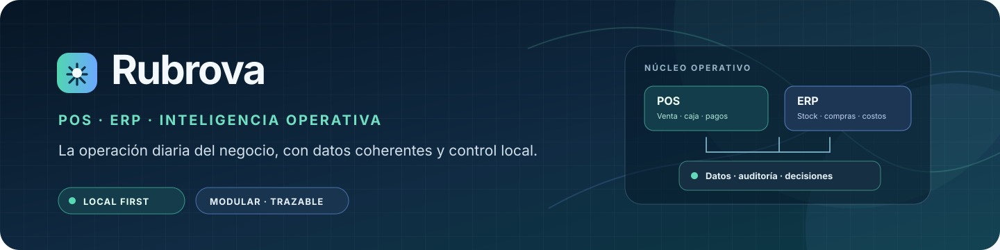
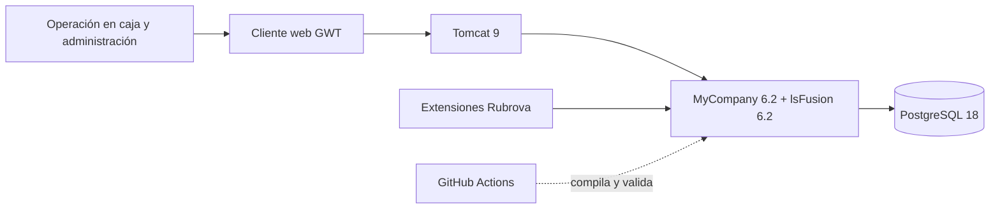

<p align="center">
  
</p>

# Rubrova

<p align="center">
  <strong>POS + ERP + inteligencia operativa para comercios y negocios con múltiples canales.</strong><br/>
  Una operación comercial coherente, trazable y preparada para decidir.
</p>

<p align="center">
  <a href="docs/EXECUTIVE_PRODUCT_BRIEF.md">Brief ejecutivo</a> ·
  <a href="docs/ENGINEERING_MASTER.md#estado-actual-de-main">Estado y evidencia</a> ·
  <a href="docs/ARCHITECTURE.md">Arquitectura</a> ·
  <a href="docs/SECURITY_POSTURE.md">Seguridad y evidencia</a> ·
  <a href="docs/ENGINEERING_MASTER.md#cómo-usar-y-mantener-este-manual">Calidad y pruebas</a>
</p>

<p align="center">
  <a href="https://github.com/JavierGrecco/Rubrova/actions/workflows/platform-extension.yml"></a>
  <a href="https://github.com/JavierGrecco/Rubrova/actions/workflows/replenishment-planner.yml"></a>
  
  
  
  
</p>

Rubrova es una plataforma de gestión comercial en desarrollo. Busca reunir la operación diaria del negocio —ventas, caja, inventario, compras, clientes y administración— sobre una base de datos coherente, trazable y preparada para análisis de gestión.

**Dirección de producto:** experiencia simple en el mostrador, control operativo completo para la administración y datos confiables para decidir.

### Product Ownership y desarrollo asistido por IA

Rubrova es un producto propio que conduzco como **Product Owner y responsable de su evolución**. Utilizo IA generativa como apoyo para investigar, diseñar e implementar, mientras mantengo la dirección del producto y la aceptación de cada entrega: defino la visión y el alcance funcional, priorizo módulos y roadmap, establezco reglas de negocio y criterios de aceptación, evalúo arquitectura y seguridad, pruebo los resultados y guío nuevas iteraciones cuando una solución no cumple lo esperado.

El uso de IA no reduce el alcance de producto ni sustituye la revisión. Las capacidades planificadas se presentan como visión y evolución progresiva; las tablas de estado y los documentos técnicos indican qué está implementado, probado, en validación o pendiente.


> **Estado del proyecto · 26 de noviembre de 2026**
>
> Rubrova continúa como piloto integrado POS + ERP; no es una versión productiva. En [la validación de plataforma #417](https://github.com/JavierGrecco/Rubrova/actions/runs/45855055565), el preflight, la compilación completa y el smoke nativo macOS ARM64 terminaron correctamente. El smoke autenticó, verificó la exportación nativa de reposición sobre fixtures, completó una venta sintética, concilió caja y stock, cerró el turno, reinició el runtime y comprobó la persistencia.
>
> La misma ejecución creó un respaldo lógico de PostgreSQL, verificó sus checksums y lo restauró en una base nueva (`rubrova_restore_ci`) sin sobrescribir `rubrova_dev`. Es una primera recuperación **sólo de PostgreSQL**: todavía no incluye adjuntos ni documentos externos. El modo offline macOS no se probó; Linux/Docker fueron omitidos y Windows sólo pasó validación sintáctica.
>
> **Estado GitHub:** `main` es la única rama visible y no hay PR abiertos. La rama principal todavía no está protegida por reglas obligatorias. La prueba en el runner Apple Silicon no sustituye la prueba en el Mac físico ni una jornada comercial real.
>
> Seguimiento: [validación de plataforma #45855055565](https://github.com/JavierGrecco/Rubrova/actions/runs/45855055565) · [estado, evidencias y criterios de aceptación](docs/ENGINEERING_MASTER.md#estado-actual-de-main) · [roadmap técnico](docs/ENGINEERING_MASTER.md#roadmap-técnico-único-y-definición-de-terminado).

## Propuesta de producto

Rubrova está pensado para negocios que necesitan algo más que una caja registradora:

- **POS y operación comercial:** catálogo, carrito editable, precios, descuentos, pagos, turnos, caja, comprobantes y devoluciones.
- **ERP de gestión:** inventario, depósitos, compras, proveedores, recepción, costos, clientes, cuentas corrientes y sucursales.
- **Múltiples canales y áreas:** local físico, online, WhatsApp, marketplaces, mayorista, distribución y servicios B2B, con lectura consolidada y por unidad de negocio.
- **Control y trazabilidad:** permisos, auditoría, movimientos compensatorios e historial de las operaciones.
- **Inteligencia comercial:** rentabilidad, demanda, estacionalidad, marcas, promociones, reposición y análisis por producto, categoría, canal y cliente.

El alcance es progresivo: primero se consolida la operación transaccional; luego se amplían las capacidades administrativas, fiscales y analíticas. Las integraciones externas y la logística avanzada no son el centro de la primera entrega.

## Principios técnicos

**Local-first.** La dirección es que el núcleo POS + ERP pueda ejecutarse en el equipo del negocio sin depender de la disponibilidad de servicios cloud. La sincronización y los conectores externos deben tolerar cortes sin detener la operación local.

**Una autoridad por dato.** Ventas, pagos, caja, inventario y documentos fiscales tienen estados relacionados, pero ciclos de vida separados. Una venta no debe duplicarse ni facturarse dos veces.

**Modularidad pragmática.** El núcleo reutiliza MyCompany/lsFusion como suite integrada. No se presenta como microservicios: se separan servicios propios sólo cuando exista un límite operativo y de datos demostrable.

**Reutilización con control.** El código base está vendorizado y versionado en el directorio vendor; las extensiones Rubrova se mantienen separadas. Los cambios de upstream no se incorporan automáticamente.

**Datos auditables.** Toda recomendación analítica debe distinguir hechos observados, supuestos y estimaciones. El planificador de reposición no crea ni confirma órdenes.

## Arquitectura y tecnología

| Capa | Implementación |
|---|---|
| Núcleo POS + ERP | MyCompany 6.2 sobre lsFusion 6.2 |
| Backend y lógica | Java 21 / lsFusion |
| Cliente web | GWT servido por Apache Tomcat 9 |
| Persistencia | PostgreSQL 18 |
| Extensiones | Módulos Rubrova en extensions/lsfusion |
| Integración de reposición | API autenticada de solo lectura + adaptador Python |
| Validación | GitHub Actions, pruebas Python, pruebas de contrato y smokes de runtime |

El runtime local nativo es la ruta prioritaria para desarrollo en macOS Apple Silicon y Linux. Docker se conserva como entorno de diagnóstico y empaquetado, no como requisito de operación local.

### Mapa del piloto técnico



El diagrama representa el núcleo integrado que estamos construyendo y probando. No describe una arquitectura de microservicios ni implica que todas las integraciones externas estén habilitadas.

## Fortalezas de ingeniería verificables

| Fortaleza | Evidencia actual | Límite conocido |
|---|---|---|
| Control del código base | Fuentes upstream fijadas y compilación propia de lsFusion/MyCompany en CI | No equivale a una auditoría completa de dependencias ni a una SBOM |
| Ejecución local nativa | Arranque, login y recorridos sintéticos verificados en runners macOS ARM64 y Linux x86_64 | Falta aceptación en equipos físicos, Windows y una instalación limpia offline |
| Resiliencia de integraciones | Escenarios CI de timeout, respuestas HTTP 408/429/503, Retry-After y recuperación de proveedor simulado | Cobertura limitada; no valida todos los flujos de escritura ni conectores reales |
| Trazabilidad operativa | Modelo y criterios definidos para relacionar ventas, pagos, caja, inventario y movimientos compensatorios | Devoluciones, arqueo completo y auditoría protegida todavía no están aceptados |
| Permisos del workflow de plataforma | El workflow principal declara `contents: read` | Hay que revisar el mínimo permiso de todos los workflows y fijar las acciones a commits inmutables |

La [postura de seguridad](docs/SECURITY_POSTURE.md) separa expresamente controles verificados, controles diseñados y puertas pendientes antes de producción. No se anuncian certificaciones ni garantías sin evidencia.


## Estado de implementación

| Área | Estado actual |
|---|---|
| Fuentes y compilación propia lsFusion/MyCompany | Compilación completa aprobada en CI |
| Runtime nativo macOS ARM64 | Smoke integrado aprobado en CI; falta prueba en el Mac físico |
| POS básico | Venta sintética en efectivo, factura/pago, stock y cierre conciliados |
| Exportación de reposición | API autenticada y exportación probadas contra fixtures sintéticas; conciliación con una base comercial real pendiente |
| Planificador de reposición | Motor y adaptadores con suites aprobadas; no genera órdenes de compra |
| Backup PostgreSQL | Creación, verificación y restauración a base nueva aprobadas en PostgreSQL 18 real de CI |
| Backup completo del negocio | Pendiente: adjuntos, documentos externos, retención, copia a disco y asistente guiado |
| Devoluciones, reintegros y arqueo físico | Pendiente de aceptación end-to-end |
| Offline macOS y Windows nativo | Pendiente de prueba funcional completa |
| Terminales de pago y ARCA | Sin adquirente homologado ni conexión fiscal productiva |
| Uso diario con datos reales | No autorizado todavía |

La evidencia y las limitaciones se mantienen en el [Manual técnico canónico](docs/ENGINEERING_MASTER.md#estado-actual-de-main); no se infieren de una compilación exitosa.

## Ejecutar localmente

El repositorio incluye una vista previa nativa sin Docker. Es un entorno de desarrollo, no un instalador comercial ni una configuración productiva.

**Requisitos:** Java 21, Maven, Python 3, PostgreSQL 18 (herramientas initdb, pg_ctl, pg_isready, createdb y psql) y Tomcat 9.0.124. La primera compilación puede descargar dependencias Maven; la primera preparación también puede descargar Tomcat y verificar su SHA-512.

Desde la raíz del repositorio:

```bash
python3 scripts/platform/runtime-config.py init

mvn -B -ntp -f build/rubrova/pom.xml -Passemble -DskipTests package
mvn -B -ntp -f vendor/platform/pom.xml -pl server,web-client -am -DskipTests package

python3 scripts/platform/run-local-native-preview.py doctor
python3 scripts/platform/run-local-native-preview.py --no-open start
```

Abrí [http://127.0.0.1:8080/login](http://127.0.0.1:8080/login). El supervisor mantiene una base de datos aislada en el directorio de datos de Rubrova y la conserva al detener los procesos con Ctrl+C.

En macOS con Homebrew, indicá las herramientas de PostgreSQL 18 antes de ejecutar el diagnóstico:

```bash
export RUBROVA_POSTGRES_BIN="$(brew --prefix postgresql@18)/bin"
export JAVA_HOME="$(/usr/libexec/java_home -v 21)"
export PATH="$JAVA_HOME/bin:$RUBROVA_POSTGRES_BIN:$PATH"
```

También existen los accesos **Iniciar Rubrova.command** y **Iniciar Rubrova - Demo.command** para macOS. La demostración usa una base separada. Consultá [Compatibilidad con macOS](docs/MACOS_SUPPORT.md) y [Instalación y runtime MyCompany](docs/MYCOMPANY_RUNTIME_INSTALL.md) antes de ejecutar.

**Seguridad de la vista previa:** se enlaza a loopback y usa una configuración local de desarrollo. No la expongas a la red ni cargues información comercial real. La instalación productiva requiere endurecimiento de credenciales, permisos, firewall, backups y restauración verificada.

### Prevalidación rápida antes de compilar

Desde la raíz del repositorio, ejecutá primero:

```bash
bash scripts/platform/local-preflight.sh
```

También podés ejecutar una capa por vez con `--platform` o `--replenishment`. Esta rutina compartida con GitHub Actions valida extensiones, contratos, tests Python/Node, fixtures y scripts sin iniciar servidores. No reemplaza Maven ni el smoke autenticado de lsFusion/MyCompany.


## Organización del repositorio

- **main** es la fuente de verdad.
- `main` es la única línea de trabajo persistente y la fuente de verdad.
- No mantener ramas de desarrollo abiertas una vez validado e integrado un hito.
- Usar una rama temporal sólo cuando el cambio necesite revisión aislada; integrarla y eliminarla al cerrar el hito.
- No apilar PR ni reabrir ramas históricas sin diferencias de contenido demostrables.
- Mantener los checks de CI como puerta previa; la protección obligatoria de `main` debe configurarse en GitHub Settings.

Ver [Política de ramas e integración](docs/BRANCHING_STRATEGY.md).

## Documentación

| Documento | Contenido |
|---|---|
| [Brief ejecutivo](docs/EXECUTIVE_PRODUCT_BRIEF.md) | Propuesta de producto, segmentos, valor, diferenciadores y estado honesto |
| [Estado del proyecto](docs/PROJECT_STATUS.md) | Evidencia de CI, capacidades aceptadas, brechas y próximos criterios |
| [Plan de trabajo](docs/ROADMAP.md) | Fases, prioridades y próximos hitos |
| [Plan maestro](docs/MASTER_IMPLEMENTATION_PLAN.md) | Secuencia ejecutiva y alcance funcional |
| [Visión de producto](docs/PRODUCT_VISION.md) | Problema, usuarios, objetivos y principios |
| [Alcance funcional](docs/FUNCTIONAL_SCOPE.md) | Capacidades del producto y límites |
| [Requisitos del POS](docs/POS_REQUIREMENTS.md) | Venta, caja, cobro, devoluciones y operación diaria |
| [Arquitectura](docs/ARCHITECTURE.md) | Componentes, límites de dominio y decisiones técnicas |
| [Modelo de dominio](docs/DOMAIN_MODEL.md) | Entidades, estados, movimientos y relaciones |
| [Datos y base analítica](docs/DATA_CAPTURE_AND_ANALYTICAL_FOUNDATION.md) | Captura histórica y dimensiones necesarias para inteligencia |
| [Demanda, rentabilidad y marcas](docs/DEMAND_AND_MARGIN_INTELLIGENCE.md) | Diseño analítico, estimaciones y evaluación reproducible |
| [Stock proyectado y reposición](docs/PROJECTED_STOCK_AND_REPLENISHMENT.md) | Contrato del planificador y semántica de inventario |
| [Resiliencia de integraciones](docs/INTEGRATION_RESILIENCE_AND_ERROR_HANDLING.md) | Timeouts, reintentos, idempotencia y recuperación |
| [Postura de seguridad y evidencia](docs/SECURITY_POSTURE.md) | Qué está verificado, qué está diseñado y qué falta antes de producción |
| [Seguridad y auditoría](docs/SECURITY_AND_AUDIT.md) | Requisitos de identidad, permisos, privacidad, pagos y auditoría |
| [Continuidad y recuperación](docs/OPERATIONAL_RESILIENCE_AND_RECOVERY.md) | Backups, restore, rollback y fallos |
| [Compatibilidad con macOS](docs/MACOS_SUPPORT.md) | Ejecución nativa en Apple Silicon |
| [Calidad y pruebas](docs/QUALITY_AND_TESTING.md) | Estrategia de validación y puertas de aceptación |
| [Base de conocimiento de ingeniería](docs/engineering/README.md) | Contratos, decisiones, relaciones entre módulos e historial de investigaciones |

## Alcance y responsabilidad

Rubrova está en desarrollo activo. Los resultados de CI demuestran escenarios específicos sobre bases sintéticas y descartables; no equivalen a homologación fiscal, pruebas con adquirentes, instalación limpia, restauración de datos ni validación de operación diaria. Las marcas, integraciones y dominios comerciales se mantienen sujetos a verificación legal y técnica antes de cualquier lanzamiento.
