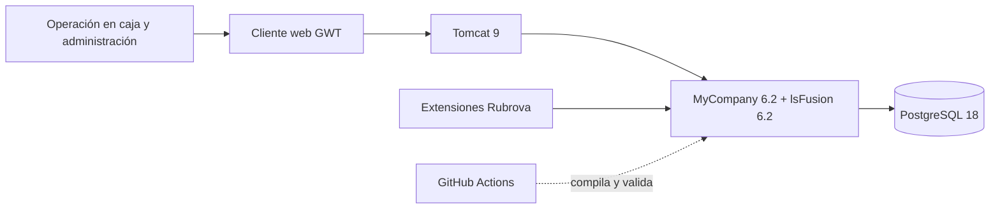

<p align="center">
  
</p>

# Rubrova

<p align="center">
  <strong>POS + ERP + inteligencia operativa para comercios y negocios con múltiples canales.</strong><br/>
  Una operación comercial coherente, trazable y preparada para decidir.
</p>

<p align="center">
  <a href="docs/EXECUTIVE_PRODUCT_BRIEF.md">Brief ejecutivo</a> ·
  <a href="docs/platform-audit/README.md">Mapeo obligatorio MyCompany / lsFusion</a> ·
  <a href="docs/platform-audit/MYCOMPANY_6_2_MODULE_INTEGRATION_DIRECTORY.md">Directorio de integración por módulo</a> ·
  <a href="docs/ENGINEERING_MASTER.md#estado-actual-de-main">Estado y evidencia</a> ·
  <a href="docs/ARCHITECTURE.md">Arquitectura</a> ·
  <a href="docs/SECURITY_POSTURE.md">Seguridad y evidencia</a> ·
  <a href="docs/ENGINEERING_MASTER.md#cómo-usar-y-mantener-este-manual">Calidad y pruebas</a>
</p>

<p align="center">
  <a href="https://github.com/JavierGrecco/Rubrova/actions/workflows/platform-extension.yml"></a>
  <a href="https://github.com/JavierGrecco/Rubrova/actions/workflows/replenishment-planner.yml"></a>
  
  
  
  
</p>

Rubrova es una plataforma de gestión comercial en desarrollo. Busca reunir la operación diaria del negocio —ventas, caja, inventario, compras, clientes y administración— sobre una base de datos coherente, trazable y preparada para análisis de gestión.

**Dirección de producto:** experiencia simple en el mostrador, control operativo completo para la administración y datos confiables para decidir.

### Product Ownership y evolución del producto

Rubrova es un producto propio bajo dirección de producto y responsabilidad explícita sobre su evolución. Esto comprende la definición de visión y alcance funcional, priorización de módulos y roadmap, reglas de negocio, criterios de aceptación, evaluación de arquitectura y seguridad, y validación de cada entrega. Las capacidades planificadas se presentan como evolución progresiva; el estado técnico y la documentación distinguen qué está implementado, probado, en validación o pendiente.


> **Estado del proyecto · 28 de noviembre de 2026**
>
> Rubrova sigue siendo un piloto integrado POS + ERP; **no es una versión productiva**.
>
> El [run #600](https://github.com/JavierGrecco/Rubrova/actions/runs/46108699011), SHA `664aef83fd89a2dd404b3e35ac43e1f2400e825c`, terminó correctamente: prevalidación compartida, validación sintáctica Windows, compilación completa de lsFusion/MyCompany 6.2 y smoke nativo macOS ARM64. El escenario autenticado abrió el POS, registró una venta sintética de ARS 1.250, pulsó la devolución nativa, abrió una nota de crédito en borrador, la descartó con la acción española `Nueva venta` y comprobó la restauración de `GRID(l)`. El descarte no generó devolución ni egreso: el turno siguió abierto con caja ARS 1.250 y el inventario permaneció en 9 unidades.
>
> El mismo smoke volvió a comprobar devoluciones parciales, rechazo de exceso, reintegros mixtos y acumulados por medio, cancelaciones, conciliación de stocktake, persistencia tras reinicio y backup/restauración de PostgreSQL en una base aislada. El backup aceptado cubre la base de datos, **no acredita todavía adjuntos ni recuperación integral en otra PC**.
>
> **Límites vigentes:** el smoke se ejecutó en macOS ARM64 sobre datos sintéticos. Linux nativo y Docker/Linux fueron omitidos; Windows sólo tuvo validación de sintaxis. `RUBROVA_NATIVE_OFFLINE_ACCEPTANCE=not_tested` y `RUBROVA_NATIVE_EGRESS_BLOCKED=false`: no afirmar aceptación offline ni aislamiento de egreso. No hay homologación con dispositivos de pago, ARCA ni una jornada comercial real.
>
> **Mapeo obligatorio:** el inventario identifica 800 módulos MyCompany, 49 módulos LSF y 3.330 fuentes Java; el cierre estático desde `RubrovaCustom` contiene 719 módulos. El relevamiento funcional integral sigue abierto en la [puerta 9.7](docs/platform-audit/README.md) y en el [issue #18](https://github.com/JavierGrecco/Rubrova/issues/18). No iniciar reemplazos propios cuando exista una capacidad nativa aún no evaluada.
>
> **Bloqueos y seguimiento:** el descarte POS tras devolver quedó aceptado en #600 y el [issue #19](https://github.com/JavierGrecco/Rubrova/issues/19) está cerrado. Siguen abiertos el [issue #17](https://github.com/JavierGrecco/Rubrova/issues/17) (cancelación de recepción prevista y reservas, hipótesis estática pendiente de reproducir), el [issue #18](https://github.com/JavierGrecco/Rubrova/issues/18) (relevamiento integral) y el [issue #9](https://github.com/JavierGrecco/Rubrova/issues/9) (warnings del build).
>
> **Estado GitHub:** `main` está en `664aef83fd89`; no hay PR abiertos. Se ve una rama histórica adicional `work/pos-refund-cumulative-method-guard`, divergida respecto de `main`; no se elimina hasta auditar su contenido exclusivo. Ninguna de las dos ramas está protegida.
>
> La especificación de [elaboración de alimentos y trazabilidad para rotiserías](docs/FOOD_PRODUCTION_AND_TRACEABILITY.md) sigue siendo diseño: metadatos de lote, retención, vencimiento, FEFO y guardas de producción no están aceptados en runtime.
>
> Seguimiento: [estado, evidencias y criterios de aceptación](docs/ENGINEERING_MASTER.md#estado-actual-de-main) · [roadmap técnico](docs/ENGINEERING_MASTER.md#roadmap-técnico-único-y-definición-de-terminado).
## Mapeo obligatorio de MyCompany 6.2 y lsFusion 6.2

Rubrova parte de dos plataformas con cientos de módulos, utilidades, mecanismos de extensión, APIs y herramientas ya implementados. **Antes de crear una función, integración o módulo propio, el equipo debe verificar qué existe en MyCompany, qué aporta lsFusion y cómo se relaciona con el resto del sistema.**

El mapeo no es una investigación opcional ni conocimiento que dependa de quien inició el proyecto. Es una condición de diseño y desarrollo para evitar duplicaciones, preservar reglas nativas y aprovechar la inversión ya incorporada en `vendor/mycompany` y `vendor/platform`.

- [Índice obligatorio de mapeo y estado de cobertura](docs/platform-audit/README.md): inventarios, dossiers por dominio, módulos fuera de la composición y pendientes reales.
- [Mapa de capacidades de lsFusion 6.2](docs/platform-audit/LSFUSION_6_2_CAPABILITY_MAP.md): lenguaje, runtime, formularios, sesiones, persistencia, APIs, clientes y herramientas.
- [Mapa funcional de MyCompany 6.2](docs/platform-audit/MYCOMPANY_6_2_FUNCTIONAL_MAP.md): composición, 800 módulos, dominios y documentación fuente.
- [Guía obligatoria de Fabricación + Proyectos](docs/platform-audit/MYCOMPANY_6_2_MANUFACTURING_PROJECTS_INTEGRATION.md): BOM, órdenes, operaciones, ledgers, proyectos, asignaciones, partes de horas, costos e integración con ventas. Incluye arquitectura de comunicación, configuración y pruebas requeridas.
- [Manual técnico canónico](docs/ENGINEERING_MASTER.md): decisiones, contratos, evidencias, estado y roadmap.

El relevamiento sigue **EN CURSO**. Que una capacidad esté inventariada, documentada o incluida por `REQUIRE` no demuestra que esté cargada, habilitada, conciliada ni aceptada en runtime. Cada avance debe consultar los mapas, justificar si reutiliza/extiende/adapta/construye y actualizar el dossier y el manual en el mismo cambio.


### Herramienta de consulta de integración por módulo

El repositorio incluye un CLI para localizar el punto de entrada técnico de **cualquier módulo del catálogo de MyCompany 6.2, lsFusion 6.2 o las extensiones de Rubrova**. Evita depender de búsquedas manuales y permite empezar cada cambio desde el nombre real declarado en `MODULE`, su fuente y sus relaciones estructurales.

**Uso desde la raíz del repositorio** (requiere Node.js; no inicia la aplicación ni necesita PostgreSQL, Tomcat o Docker):

```bash
# Consultar por el nombre exacto declarado en MODULE
node scripts/platform/module-integration-route.mjs --module InvLedger

# También acepta el nombre exacto del archivo .lsf o su ruta dentro del repositorio
node scripts/platform/module-integration-route.mjs --module PurchaseOrder.lsf
node scripts/platform/module-integration-route.mjs --module vendor/mycompany/src/main/lsfusion/purchase/orders/PurchaseOrder.lsf

# Obtener las mismas relaciones en JSON para scripts o análisis automatizados
node scripts/platform/module-integration-route.mjs --module InvLedger --json

# Consultar la sintaxis
node scripts/platform/module-integration-route.mjs --help
```

También admite `-m` como alias de `--module` y `--json` para emitir una respuesta JSON sin texto adicional, apta para scripts y otras validaciones. La coincidencia se hace por nombre de módulo, nombre de archivo o ruta exacta (sin distinguir mayúsculas/minúsculas). Si no encuentra una coincidencia exacta, devuelve sugerencias; si hay más de una coincidencia, informa la ambigüedad. Las sugerencias no se deben tratar como una resolución automática.

**Qué devuelve la consulta:**

- **Identidad y procedencia:** nombre `MODULE`, producto de origen, ruta LSF, namespace, dominio y commit/tag del snapshot.
- **Composición:** indica si el módulo aparece dentro o fuera del cierre estático alcanzable desde `RubrovaCustom`. Un módulo fuera del cierre no debe considerarse activo; estar dentro tampoco demuestra por sí solo que esté cargado o habilitado en un runtime concreto.
- **Relaciones de código:** lista `REQUIRE` y consumidores directos, además de sus dependencias y consumidores transitivos. Informa la profundidad de cada relación y separa referencias no resueltas o ambiguas. Es un grafo estructural, no el mapa completo de relaciones funcionales o de negocio.
- **Ruta de lectura:** prioriza una ficha individual cuando existe, enlaza el dossier del dominio y propone lecturas transversales (datos maestros, utilidades compartidas, capacidades lsFusion, arquitectura, composición u otras según corresponda). Cuando falta una ficha individual, señala la plantilla para crearla sin completar vacíos por suposición.
- **Resumen de fuente:** muestra conteos y nombres detectados de clases, propiedades, acciones, formularios, restricciones, eventos y anotaciones API, junto con las limitaciones del análisis. En JSON quedan disponibles los campos `transitiveRequires`, `transitiveConsumers`, `unresolvedTransitiveRequires` y las relaciones ambiguas.

**Cómo usar el resultado:** leer primero la ficha/dossier recomendado, abrir la fuente LSF exacta, revisar por separado dependencias `REQUIRE` y consumidores, y seguir las relaciones de negocio que correspondan (documentos, estados, reservas, pagos, costos y ledgers). Confirmar además la composición real desde `RubrovaCustom`. Si el análisis individual no existe o es insuficiente, completar `docs/platform-audit/MODULE_INTEGRATION_PASSPORT_TEMPLATE.md` y enlazar la nueva ficha en el directorio antes de aprobar la integración.

**Límites importantes:** el CLI genera una ruta de investigación a partir de un catálogo estático de los snapshots fijados en `platform/source-lock.json`. No ejecuta lsFusion/MyCompany, no inspecciona pantallas en funcionamiento, no resuelve por sí solo todas las relaciones de negocio, no expande metacódigo `META`/macros y no prueba permisos, transacciones, efectos, conciliación ni comportamiento de runtime. La detección de algunas declaraciones —en particular acciones— es heurística. Por eso, sus conteos no son una medida de funcionalidad disponible ni reemplazan la lectura de fuente, las fichas funcionales o las pruebas.

**Validación de la herramienta:**

```bash
node --test scripts/platform/module-integration-route.test.mjs
bash scripts/platform/local-preflight.sh --platform
```

El preflight de plataforma ejecuta las pruebas del CLI y varias consultas representativas. Esta herramienta y sus pruebas están versionadas en [`scripts/platform/module-integration-route.mjs`](scripts/platform/module-integration-route.mjs), [`scripts/platform/module-integration-route.test.mjs`](scripts/platform/module-integration-route.test.mjs) y [`scripts/platform/audit-lsf-source.mjs`](scripts/platform/audit-lsf-source.mjs). El procedimiento general de mapeo está en [el índice obligatorio de MyCompany/lsFusion](docs/platform-audit/README.md).

## Propuesta de producto

Rubrova está pensado para negocios que necesitan algo más que una caja registradora:

- **POS y operación comercial:** catálogo, carrito editable, precios, descuentos, pagos, turnos, caja, comprobantes y devoluciones.
- **ERP de gestión:** inventario, depósitos, compras, proveedores, recepción, costos, clientes, cuentas corrientes y sucursales.
- **Múltiples canales y áreas:** local físico, online, WhatsApp, marketplaces, mayorista, distribución y servicios B2B, con lectura consolidada y por unidad de negocio.
- **Control y trazabilidad:** permisos, auditoría, movimientos compensatorios e historial de las operaciones.
- **Inteligencia comercial:** rentabilidad, demanda, estacionalidad, marcas, promociones, reposición y análisis por producto, categoría, canal y cliente.

El alcance es progresivo: primero se consolida la operación transaccional; luego se amplían las capacidades administrativas, fiscales y analíticas. Las integraciones externas y la logística avanzada no son el centro de la primera entrega.

## Principios técnicos

**Local-first.** La dirección es que el núcleo POS + ERP pueda ejecutarse en el equipo del negocio sin depender de la disponibilidad de servicios cloud. La sincronización y los conectores externos deben tolerar cortes sin detener la operación local.

**Una autoridad por dato.** Ventas, pagos, caja, inventario y documentos fiscales tienen estados relacionados, pero ciclos de vida separados. Una venta no debe duplicarse ni facturarse dos veces.

**Modularidad pragmática.** El núcleo reutiliza MyCompany/lsFusion como suite integrada. No se presenta como microservicios: se separan servicios propios sólo cuando exista un límite operativo y de datos demostrable.

**Reutilización con control.** El código base está vendorizado y versionado en el directorio vendor; las extensiones Rubrova se mantienen separadas. Los cambios de upstream no se incorporan automáticamente.

**Datos auditables.** Toda recomendación analítica debe distinguir hechos observados, supuestos y estimaciones. El planificador de reposición no crea ni confirma órdenes.

## Arquitectura y tecnología

| Capa | Implementación |
|---|---|
| Núcleo POS + ERP | MyCompany 6.2 sobre lsFusion 6.2 |
| Backend y lógica | Java 21 / lsFusion |
| Cliente web | GWT servido por Apache Tomcat 9 |
| Persistencia | PostgreSQL 18 |
| Extensiones | Módulos Rubrova en extensions/lsfusion |
| Integración de reposición | API autenticada de solo lectura + adaptador Python |
| Validación | GitHub Actions, pruebas Python, pruebas de contrato y smokes de runtime |

El runtime local nativo es la ruta prioritaria para desarrollo en macOS Apple Silicon y Linux. Docker se conserva como entorno de diagnóstico y empaquetado, no como requisito de operación local.

### Mapa del piloto técnico



El diagrama representa el núcleo integrado que estamos construyendo y probando. No describe una arquitectura de microservicios ni implica que todas las integraciones externas estén habilitadas.

## Fortalezas de ingeniería verificables

| Fortaleza | Evidencia actual | Límite conocido |
|---|---|---|
| Control del código base | Fuentes upstream fijadas y compilación propia de lsFusion/MyCompany en CI | No equivale a una auditoría completa de dependencias ni a una SBOM |
| Ejecución local nativa | Arranque, login y recorridos sintéticos verificados en runners macOS ARM64 y Linux x86_64 | Falta aceptación en equipos físicos, Windows y una instalación limpia offline |
| Resiliencia de integraciones | Escenarios CI de timeout, respuestas HTTP 408/429/503, Retry-After y recuperación de proveedor simulado | Cobertura limitada; no valida todos los flujos de escritura ni conectores reales |
| Trazabilidad operativa | Modelo y criterios definidos para relacionar ventas, pagos, caja, inventario y movimientos compensatorios | Devoluciones, arqueo completo y auditoría protegida todavía no están aceptados |
| Permisos del workflow de plataforma | El workflow principal declara `contents: read` | Hay que revisar el mínimo permiso de todos los workflows y fijar las acciones a commits inmutables |

La [postura de seguridad](docs/SECURITY_POSTURE.md) separa expresamente controles verificados, controles diseñados y puertas pendientes antes de producción. No se anuncian certificaciones ni garantías sin evidencia.


## Estado de implementación

| Área | Estado actual |
|---|---|
| Fuentes y compilación propia lsFusion/MyCompany | Compilación completa aprobada en CI |
| Runtime nativo macOS ARM64 | Smoke integrado aprobado en CI; falta prueba en el Mac físico |
| POS básico | Venta sintética en efectivo, factura/pago, stock y cierre conciliados |
| Exportación de reposición | API autenticada y exportación probadas contra fixtures sintéticas; conciliación con una base comercial real pendiente |
| Planificador de reposición | Motor y adaptadores con suites aprobadas; no genera órdenes de compra |
| Backup PostgreSQL | Creación, verificación y restauración a base nueva aprobadas en PostgreSQL 18 real de CI |
| Backup completo del negocio | Pendiente: adjuntos, documentos externos, retención, copia a disco y asistente guiado |
| Devoluciones, reintegros y arqueo físico | Pendiente de aceptación end-to-end |
| Offline macOS y Windows nativo | Pendiente de prueba funcional completa |
| Terminales de pago y ARCA | Sin adquirente homologado ni conexión fiscal productiva |
| Uso diario con datos reales | No autorizado todavía |

La evidencia y las limitaciones se mantienen en el [Manual técnico canónico](docs/ENGINEERING_MASTER.md#estado-actual-de-main); no se infieren de una compilación exitosa.

## Ejecutar localmente

El repositorio incluye una vista previa nativa sin Docker. Es un entorno de desarrollo, no un instalador comercial ni una configuración productiva.

**Requisitos:** Java 21, Maven, Python 3, PostgreSQL 18 (herramientas initdb, pg_ctl, pg_isready, createdb y psql) y Tomcat 9.0.124. La primera compilación puede descargar dependencias Maven; la primera preparación también puede descargar Tomcat y verificar su SHA-512.

Desde la raíz del repositorio:

```bash
python3 scripts/platform/runtime-config.py init

mvn -B -ntp -f build/rubrova/pom.xml -Passemble -DskipTests package
mvn -B -ntp -f vendor/platform/pom.xml -pl server,web-client -am -DskipTests package

python3 scripts/platform/run-local-native-preview.py doctor
python3 scripts/platform/run-local-native-preview.py --no-open start
```

Abrí [http://127.0.0.1:8080/login](http://127.0.0.1:8080/login). El supervisor mantiene una base de datos aislada en el directorio de datos de Rubrova y la conserva al detener los procesos con Ctrl+C.

En macOS con Homebrew, indicá las herramientas de PostgreSQL 18 antes de ejecutar el diagnóstico:

```bash
export RUBROVA_POSTGRES_BIN="$(brew --prefix postgresql@18)/bin"
export JAVA_HOME="$(/usr/libexec/java_home -v 21)"
export PATH="$JAVA_HOME/bin:$RUBROVA_POSTGRES_BIN:$PATH"
```

También existen los accesos **Iniciar Rubrova.command** y **Iniciar Rubrova - Demo.command** para macOS. La demostración usa una base separada. Consultá [Compatibilidad con macOS](docs/MACOS_SUPPORT.md) y [Instalación y runtime MyCompany](docs/MYCOMPANY_RUNTIME_INSTALL.md) antes de ejecutar.

**Seguridad de la vista previa:** se enlaza a loopback y usa una configuración local de desarrollo. No la expongas a la red ni cargues información comercial real. La instalación productiva requiere endurecimiento de credenciales, permisos, firewall, backups y restauración verificada.

### Prevalidación rápida antes de compilar

Desde la raíz del repositorio, ejecutá primero:

```bash
bash scripts/platform/local-preflight.sh
```

También podés ejecutar una capa por vez con `--platform` o `--replenishment`. Esta rutina compartida con GitHub Actions valida extensiones, contratos, tests Python/Node, fixtures y scripts sin iniciar servidores. No reemplaza Maven ni el smoke autenticado de lsFusion/MyCompany.


## Organización del repositorio

- **main** es la fuente de verdad.
- `main` es la única línea de trabajo persistente y la fuente de verdad.
- No mantener ramas de desarrollo abiertas una vez validado e integrado un hito.
- Usar una rama temporal sólo cuando el cambio necesite revisión aislada; integrarla y eliminarla al cerrar el hito.
- No apilar PR ni reabrir ramas históricas sin diferencias de contenido demostrables.
- Mantener los checks de CI como puerta previa; la protección obligatoria de `main` debe configurarse en GitHub Settings.

Ver [Política de ramas e integración](docs/BRANCHING_STRATEGY.md).

## Documentación

| Documento | Contenido |
|---|---|
| [Brief ejecutivo](docs/EXECUTIVE_PRODUCT_BRIEF.md) | Propuesta de producto, segmentos, valor, diferenciadores y estado honesto |
| [Manual técnico canónico](docs/ENGINEERING_MASTER.md) | Estado, evidencia, arquitectura, contratos, decisiones, reutilización y roadmap técnico en una sola fuente |


| [Visión de producto](docs/PRODUCT_VISION.md) | Problema, usuarios, objetivos y principios |
| [Alcance funcional](docs/FUNCTIONAL_SCOPE.md) | Capacidades del producto y límites |
| [Requisitos del POS](docs/POS_REQUIREMENTS.md) | Venta, caja, cobro, devoluciones y operación diaria |
| [Arquitectura](docs/ARCHITECTURE.md) | Componentes, límites de dominio y decisiones técnicas |
| [Modelo de dominio](docs/DOMAIN_MODEL.md) | Entidades, estados, movimientos y relaciones |
| [Datos y base analítica](docs/DATA_CAPTURE_AND_ANALYTICAL_FOUNDATION.md) | Captura histórica y dimensiones necesarias para inteligencia |
| [Demanda, rentabilidad y marcas](docs/DEMAND_AND_MARGIN_INTELLIGENCE.md) | Diseño analítico, estimaciones y evaluación reproducible |
| [Stock proyectado y reposición](docs/PROJECTED_STOCK_AND_REPLENISHMENT.md) | Contrato del planificador y semántica de inventario |
| [Resiliencia de integraciones](docs/INTEGRATION_RESILIENCE_AND_ERROR_HANDLING.md) | Timeouts, reintentos, idempotencia y recuperación |
| [Postura de seguridad y evidencia](docs/SECURITY_POSTURE.md) | Qué está verificado, qué está diseñado y qué falta antes de producción |
| [Seguridad y auditoría](docs/SECURITY_AND_AUDIT.md) | Requisitos de identidad, permisos, privacidad, pagos y auditoría |
| [Continuidad y recuperación](docs/OPERATIONAL_RESILIENCE_AND_RECOVERY.md) | Backups, restore, rollback y fallos |
| [Compatibilidad con macOS](docs/MACOS_SUPPORT.md) | Ejecución nativa en Apple Silicon |


## Alcance y responsabilidad

Rubrova está en desarrollo activo. Los resultados de CI demuestran escenarios específicos sobre bases sintéticas y descartables; no equivalen a homologación fiscal, pruebas con adquirentes, instalación limpia, restauración de datos ni validación de operación diaria. Las marcas, integraciones y dominios comerciales se mantienen sujetos a verificación legal y técnica antes de cualquier lanzamiento.
