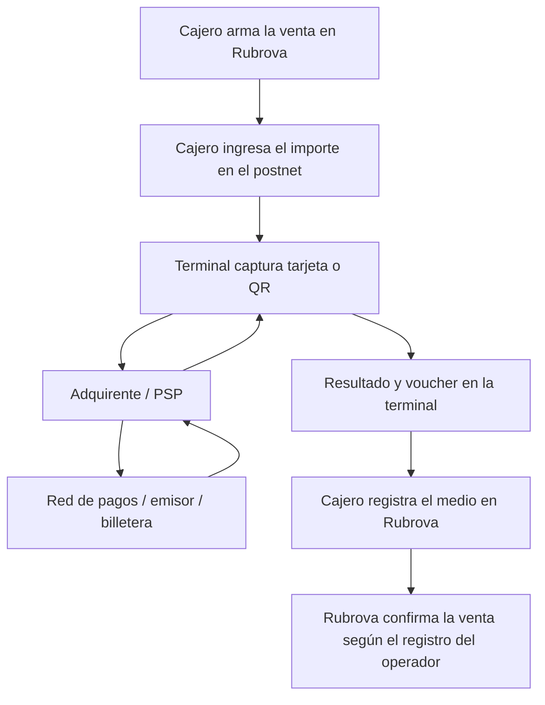
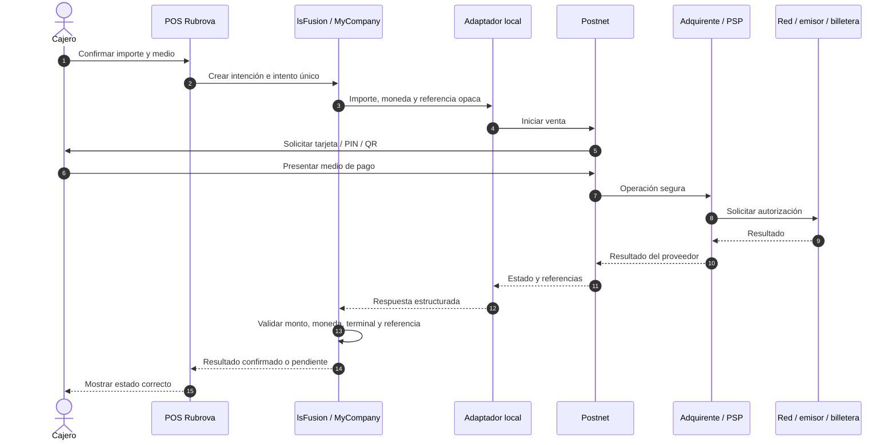
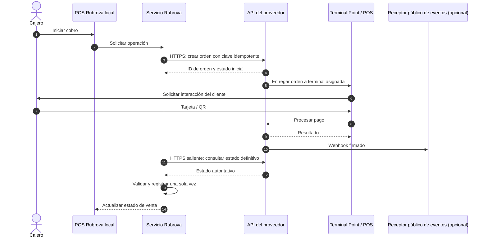
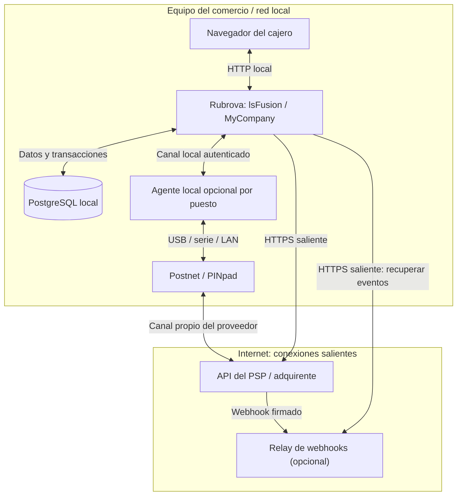
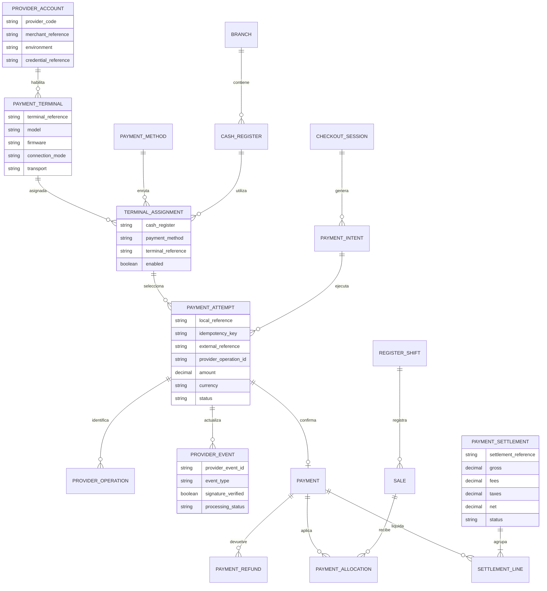
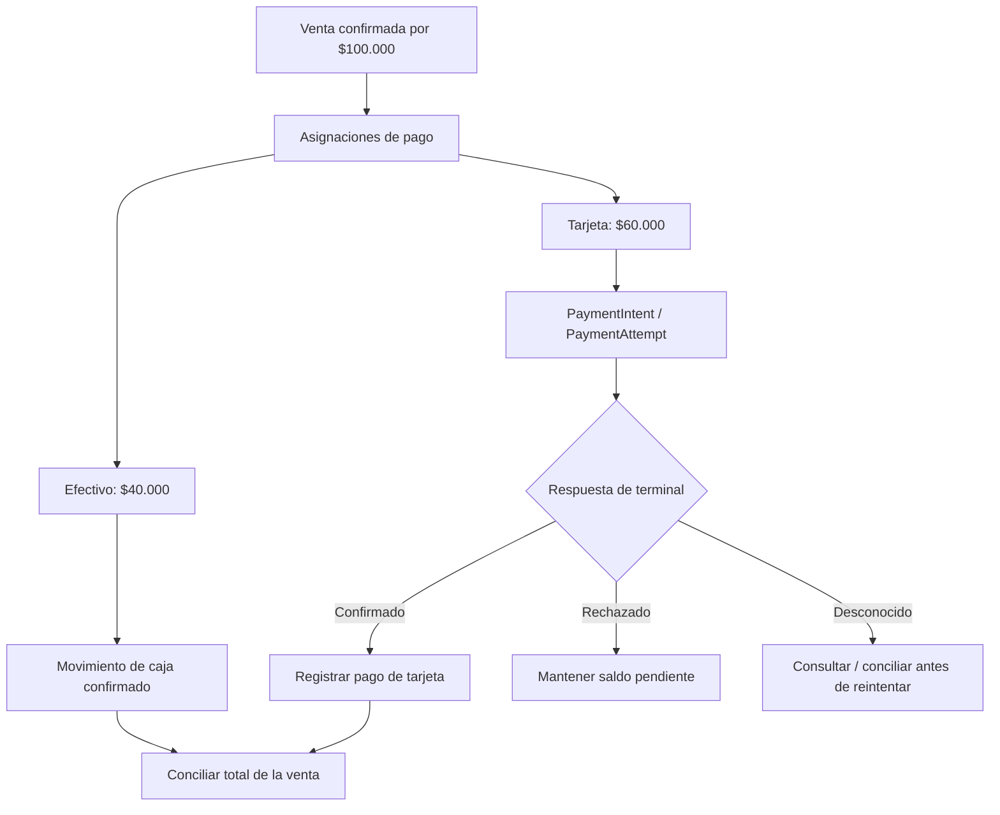

# Arquitectura de terminales de pago y conciliación

**Revisión:** 24 de noviembre de 2026  
**Estado:** arquitectura y contrato de dominio definidos; se incorporó el primer modelo persistente de configuración y trazabilidad. No hay todavía un adaptador productivo homologado ni una prueba con un postnet físico.

Este documento describe cómo debe conectarse Rubrova con terminales bancarias y billeteras. La regla principal es sencilla: **Rubrova administra la venta y registra el resultado; la terminal y el proveedor de pagos procesan la tarjeta, el PIN, el QR y la autorización financiera.**

La terminal no es el banco ni el adquirente. Es el dispositivo seguro que captura el medio de pago y conversa con la infraestructura de pagos contratada por el comercio.

## 1. Alcance y límites de responsabilidad

Rubrova no va a desarrollar una red de tarjetas, un procesador adquirente ni un lector de tarjetas propio. Tampoco va a capturar ni almacenar PAN completo, banda magnética, PIN, PIN block o CVV/CVC.

Las responsabilidades quedan separadas:

| Componente | Responsabilidad |
|---|---|
| POS Rubrova | Carrito, importe, caja, turno, cliente comercial, selección del medio, referencia y resultado local. |
| Servicio lsFusion/MyCompany | Reglas comerciales, transacciones, pagos contables, movimientos de caja, stock y documentos. |
| Adaptador de terminal | Traducir el contrato común Rubrova al SDK, protocolo local o API de un proveedor. |
| Terminal/postnet | Interacción segura con el cliente, captura de tarjeta/PIN/QR, instrucciones en pantalla y voucher del adquirente. |
| PSP/adquirente/procesador | Autorización, captura, procesamiento, reversos, devoluciones y notificaciones. |
| Red/emisor/billetera | Enrutamiento y autorización que corresponda al instrumento utilizado. |
| Conciliación | Comparar pagos confirmados con lotes/liquidaciones y movimientos bancarios. |

Un pago aprobado por la terminal no es necesariamente una acreditación bancaria ya visible en la cuenta del comercio. Por eso Rubrova conserva estados diferentes para **pago confirmado** y **liquidación acreditada**.

## 2. Tres formas de operar

### 2.1 Terminal autónoma: operación manual

La terminal funciona por sí misma. El cajero introduce el importe en el postnet y Rubrova no le envía una orden ni recibe una respuesta automática.

**Qué sabe Rubrova:** lo que el operador registra y, si lo incorpora, la referencia impresa o visible en el comprobante.

**Qué no sabe Rubrova:** si la operación bancaria fue realmente autorizada, si el importe ingresado en el postnet coincidió con la venta o si el voucher corresponde a esa venta, salvo que se realice una comprobación externa.

En el modo autónomo, una confirmación manual es una declaración del operador, no una autorización verificada por Rubrova. Debe conservarse el usuario, la hora, la referencia y el modo de registro para permitir la conciliación posterior. Nunca debe presentarse como una confirmación automática de la terminal.

Este modo es el camino de compatibilidad universal: permite trabajar con postnets que no ofrecen API ni SDK. También sirve como alternativa ante una caída de la integración, siempre que el operador pueda comprobar el resultado en el dispositivo.

### 2.2 Integración local: el POS envía el importe a la terminal

Rubrova crea una operación, la envía al conector local y este inicia el flujo seguro de pago de la terminal. La comunicación financiera sigue perteneciendo al proveedor.

La API local puede ser USB, puerto serie, TCP/IP, Wi-Fi o una biblioteca del fabricante. El protocolo concreto depende del proveedor, modelo, firmware, licencia y homologación.

**El adaptador no debe leer la tarjeta ni el PIN.** Sólo transmite los datos que el proveedor permita y devuelve referencias y estados de la operación.

Si el terminal está conectado por USB al puesto del cajero, el adaptador puede tener que ejecutarse en ese mismo puesto. No se debe suponer que un servidor central podrá controlar físicamente un dispositivo conectado a otra computadora sin un agente local por puesto.

### 2.3 Integración cloud-to-cloud: el POS coordina y el proveedor notifica

En esta modalidad, Rubrova utiliza HTTPS para crear una orden en el servicio del proveedor. El dispositivo vinculado a la cuenta comercial recibe la orden por la infraestructura del proveedor. El proveedor informa el resultado mediante webhook y/o consulta de estado.

Un webhook público no puede llegar a `127.0.0.1` de la PC del comercio. Las opciones son:

1. **Consulta saliente:** el servicio local pregunta por el estado de la orden con una frecuencia y vencimiento acotados.
2. **Relay de eventos:** un endpoint público recibe la notificación, verifica la firma y conserva el evento; el servicio local lo obtiene por HTTPS saliente.
3. **SDK o conector administrado por el proveedor:** si la solución documentada ofrece un canal alternativo, se respeta su contrato.

Rubrova no abrirá PostgreSQL, RMI ni el panel de administración a Internet para recibir notificaciones.

## 3. Límite de confianza y red del comercio

Reglas obligatorias:

- PostgreSQL, RMI y las interfaces administrativas permanecen en loopback o red privada autorizada; nunca se publican para que un adquirente los alcance.
- Los endpoints locales del adaptador se limitan a loopback o a la subred privada estrictamente necesaria.
- Las conexiones con PSP/adquirentes usan TLS y validan certificados.
- La autenticación local del adaptador no depende de confiar en cualquier proceso del equipo: usa un secreto de sesión, identidad de proceso o autenticación mutua según el SDK.
- El secreto comercial se almacena en el almacén seguro del sistema operativo o en un servicio de secretos protegido. La base sólo puede guardar una referencia a ese secreto, nunca su valor.
- Los logs registran IDs, importes, estados y categorías saneadas; no registran credenciales, datos completos de tarjeta, PIN, CVV ni cuerpos sensibles.
- Un timeout o una pérdida de conexión después de enviar una operación produce estado incierto, no un rechazo inventado.

## 4. Entidades y relaciones

La venta, el intento de cobro, el pago contable y la liquidación bancaria son hechos diferentes. No se debe convertir una solicitud enviada a la terminal en un pago confirmado.

### Responsabilidad de cada entidad

| Entidad | Responsabilidad |
|---|---|
| `ProviderAccount` | Identidad comercial del comercio dentro del PSP/adquirente, ambiente y referencia al secreto externo. |
| `PaymentTerminal` | Equipo físico: proveedor, modelo, firmware, referencia externa y capacidad de conexión. |
| `TerminalAssignment` | Relaciona terminal, caja y medio de pago. Permite saber qué dispositivo utilizar para esa operación. |
| `CheckoutSession` | Carrito y contexto de cobro aún modificable antes del despacho a terminal. |
| `PaymentIntent` | Importe y moneda que se pretende cobrar para una venta o pedido. |
| `PaymentAttempt` | Ejecución concreta contra una terminal o proveedor. Un intent puede tener varios intentos, nunca simultáneos sin control. |
| `ProviderOperation` | ID externo, ID de orden, referencia de autorización y estado recibido del proveedor. |
| `ProviderEvent` | Webhook o evento recibido, su ID, verificación, procesamiento e idempotencia. |
| `Payment` | Pago que Rubrova reconoce como confirmado y que puede entrar al circuito contable existente. |
| `PaymentAllocation` | Distribución de un pago entre venta, documento o saldo. |
| `PaymentRefund` | Reintegro total o parcial vinculado al pago original. |
| `PaymentSettlement` | Resumen del lote/liquidación del proveedor. |
| `SettlementLine` | Relación de una operación con su liquidación, comisiones, impuestos y neto. |

En MyCompany, `PaymentMethod` y `IncomingPayment` ya representan el método y el movimiento de cobro contable. El intento de terminal no los reemplaza. Sólo después de una confirmación válida se debe invocar el flujo de pago existente de MyCompany/Rubrova.

## 5. Estados: pago y liquidación separados

### 5.1 Estado canónico de un intento

Los proveedores utilizan nombres diferentes. Cada adaptador mapea los estados originales al vocabulario común:

| Estado Rubrova | Significado | ¿Confirma la venta? |
|---|---|---|
| `created` | Intento local creado; todavía no se despachó. | No |
| `dispatched` | Orden transmitida al proveedor/terminal. | No |
| `awaiting_customer` | La terminal espera tarjeta, PIN, QR u otra acción. | No |
| `processing` | El proveedor está procesando. | No |
| `approved` | Proveedor informa resultado exitoso, pero aún falta validar el contrato del proveedor y el estado de cobro final. | Sólo cuando el adaptador lo declara final y verificable |
| `declined` | Rechazado por el proveedor. | No |
| `cancel_requested` | Se solicitó cancelar; no es una cancelación confirmada. | No |
| `cancelled` | El proveedor confirmó que no se completó el cobro. | No |
| `expired` | Orden vencida sin cobro confirmado. | No |
| `unknown` | Se perdió respuesta o no se conoce el resultado. | No; requiere consulta |
| `reconciliation_required` | Hay datos contradictorios o falta comprobar el resultado. | No |
| `refund_pending` | Reembolso solicitado pero aún no confirmado. | El pago original permanece confirmado |
| `partially_refunded` | Reembolso parcial confirmado. | Sí, por el saldo neto |
| `refunded` | Reembolso total confirmado. | No queda saldo cobrado |

El estado `approved` no se debe interpretar igual para todos los proveedores sin revisar la documentación del producto y el modelo contratado. El adaptador debe determinar cuál de sus estados representa una operación final cobrable y mapearlo a la confirmación común.

Una autorización, una orden creada, una orden entregada al terminal, una respuesta HTTP 202 o un mensaje visual del navegador no bastan por sí solos para confirmar el pago.

### 5.2 Estado de liquidación

La acreditación se representa por separado:

- `unsettled`: pago confirmado, todavía no incluido en una liquidación conocida.
- `included`: asociado a un lote o liquidación.
- `settled`: proveedor informa liquidación.
- `partially_settled`: liquidación parcial.
- `disputed`: diferencia entre operación, liquidación o extracto.
- `reconciled`: conciliación final con la cuenta bancaria del comercio.

El importe neto esperado debe conservar el detalle: bruto, comisión, impuestos, retenciones, ajustes y neto. No inferir el neto como si todos los proveedores cobraran la misma tarifa.

## 6. Invariantes transaccionales

1. Una venta conserva una referencia estable durante todo el checkout.
2. Cada intento tiene un ID local, una clave idempotente y una referencia externa opaca, sin datos personales.
3. Una misma clave idempotente siempre conserva el mismo importe, moneda, terminal y contenido de la solicitud.
4. Una operación con resultado incierto no se reenvía a ciegas.
5. Primero se consulta el estado por referencia externa o se usa el mecanismo idempotente oficial del proveedor.
6. Se valida proveedor, cuenta comercial, terminal, importe, moneda, operación y estado antes de confirmar.
7. Un webhook repetido no crea un segundo pago ni otra salida de stock.
8. Dos notificaciones contradictorias no pueden hacer retroceder un pago ya confirmado.
9. La confirmación del pago y la creación contable se ejecutan una sola vez.
10. Un pago mixto se compone de asignaciones independientes; cada componente debe confirmarse por separado.
11. El reembolso siempre apunta al pago original y no se representa como modificación del pago histórico.
12. La impresión del voucher no determina el estado financiero ni revierte una venta ya confirmada.
13. El pago confirmado no equivale a liquidación acreditada.
14. La indisponibilidad del proveedor no detiene las funciones locales que no dependen de él.

## 7. Casos de uso

### 7.1 Venta de $100.000: efectivo más tarjeta

No registrar $100.000 como efectivo. Si la tarjeta es rechazada o está incierta, no fingir que el total está cobrado.

### 7.2 Timeout después de enviar al postnet

1. Rubrova ya guardó el intento y su clave idempotente.
2. Se envió la orden.
3. Se agotó el tiempo de espera antes de recibir la respuesta.
4. El estado pasa a `unknown`.
5. La interfaz informa que debe verificarse el cobro en el postnet o consultar al proveedor.
6. El adaptador consulta la operación existente con la referencia original.
7. Sólo si el proveedor confirma que no hubo cobro y permite un nuevo intento se habilita el reintento.
8. Si el proveedor confirma el pago, se registra una sola vez.
9. Si no hay información suficiente, queda pendiente de conciliación y no se vuelve a cobrar automáticamente.

### 7.3 Modo autónomo de emergencia

Cuando el integrador no funciona, el cajero puede utilizar la terminal manualmente. Rubrova registra el modo autónomo y exige que el operador confirme que verificó el resultado en la terminal. La operación queda identificada para conciliación posterior. Cuando vuelve el adaptador no se vuelve a crear el mismo cobro.

### 7.4 Devolución parcial

La devolución se solicita contra el ID del pago original, se espera confirmación del proveedor y se registra como un movimiento compensatorio. Nunca se elimina ni se cambia el pago original. La devolución contable, el reintegro bancario y el retorno físico al inventario siguen siendo tres procesos relacionados pero distintos.

## 8. Adaptadores y compatibilidad

El contrato común no debe contener particularidades de una marca. Cada adaptador implementa:

- Descubrir terminal, validar conexión y consultar estado.
- Iniciar venta con importe, moneda e identificador opaco.
- Consultar una operación existente.
- Solicitar cancelación y confirmar su estado final.
- Solicitar devolución total/parcial y consultar su resultado.
- Obtener datos de conciliación y liquidación cuando el proveedor lo permita.
- Traducir estados, códigos y errores propios al contrato común.
- Declarar capacidades reales del modelo: tarjeta, QR, propina, cuotas, reimpresión, voucher, cancelación, devolución y operación sin conexión.

| Proveedor/solución | Tipo documentado | Consideración para Rubrova |
|---|---|---|
| Mercado Pago Point Smart | Orders API con asignación de terminal, respuesta asíncrona y notificaciones. También hay modo autónomo. | Primer candidato de integración cloud-to-cloud. El equipo Point y la cuenta deben estar vinculados y habilitados. |
| Getnet Get POS Integrado | SDK/conector local por USB/serie o red y opción Cloud2Cloud según producto. | Buen candidato para probar un puente local real. Requiere SDK, credenciales y terminal homologada. |
| Fiserv / Posnet | Terminal autónoma, lote/archivo y modalidad integrada Trx a Trx según el producto y contrato. | Solicitar protocolo, programa, cable, terminales compatibles y certificación. No asumir que cualquier Posnet expone API local. |
| Payway / PayStore | Catálogo de APIs de operaciones de terminal, reintegros, reversiones y liquidaciones. | Candidato posterior a obtener acceso técnico, credenciales y equipos compatibles. |

La matriz de compatibilidad que acompaña a cada release debe incluir:

- proveedor, producto, adquirente y cuenta comercial;
- modelo exacto, firmware y versión de aplicación;
- tipo de conexión y protocolo/SDK;
- sistema operativo del agente local, arquitectura CPU y versión;
- capacidades, restricciones y permisos habilitados;
- estado de pruebas, homologación y aceptación física.

No declarar compatibilidad genérica con «Posnet», «Ingenico» o «Mercado Pago» sin detallar modelo, modalidad y firmware probados.

## 9. Sistema operativo y runtime local

El núcleo de pago se ejecuta con Rubrova y lsFusion/MyCompany, independientemente del sistema operativo. La capa de comunicación física es la que puede variar.

| Modalidad | macOS | Windows | Linux |
|---|---|---|---|
| API cloud HTTPS | Independiente de OS, con conectividad saliente y certificados válidos. | Igual. | Igual. |
| USB/serie/SDK nativo | Sólo si el proveedor entrega y soporta la biblioteca/macOS. | Sólo con driver/SDK compatible. | Sólo con driver/SDK compatible. |
| Agente local en red | Requiere una implementación y política de seguridad compatibles. | Ídem. | Ídem. |
| Modo autónomo/manual | Compatible como procedimiento del comercio; no implica integración técnica. | Igual. | Igual. |

Si el SDK bancario sólo está disponible para Windows o Android, no se debe prometer que funcionará en Mac por utilizar Java o lsFusion. Se documenta el límite del proveedor y se ofrece otro modo de conexión compatible.

Para una instalación local de un solo puesto, el adaptador puede correr como un proceso/servicio en el mismo equipo. Para varios puestos, cada dispositivo físico puede necesitar un agente local autorizado. La asignación de terminal debe apuntar al agente y a la caja correctos.

## 10. Resiliencia y operación

- Timeout por operación, configurable y acotado.
- Sin reintentos automáticos de operaciones de cobro con resultado incierto.
- Reintentos de consulta sólo para lecturas idempotentes, con espera progresiva y límite.
- Circuit breaker para que un PSP caído no bloquee el POS.
- Registro duradero de intentos y eventos.
- Outbox para confirmaciones locales y procesamiento posterior.
- Deducción de duplicados mediante IDs de evento y referencia del proveedor.
- Consulta de estado tras reinicio del servidor.
- Health check separado para la terminal, el adaptador y el proveedor online.
- Mensajes de operador en español que indiquen qué se sabe y qué no se sabe.
- Pruebas de caída del proveedor, desconexión USB, pérdida de respuesta, duplicación de webhook, reinicio del equipo y restauración de backup.
- No guardar payloads sensibles de tarjeta ni cuerpos HTTP enteros en registros de diagnóstico.

## 11. Estado de implementación en Rubrova

### Incorporado en este cambio

- Arquitectura de tres modalidades y límites de confianza.
- Diagramas de secuencia y relaciones del dominio.
- Modelo inicial en lsFusion para cuentas de proveedor, terminales, asignaciones, intenciones, intentos, eventos, reintegros, liquidaciones y sus líneas.
- Pantallas de administración y consulta de la configuración y trazabilidad.
- Separación explícita de credenciales (referencia al almacén seguro, nunca el secreto).
- Contrato de estados y reglas de conciliación documentado.

### Todavía pendiente, no habilitado para producción

- Adaptador real de un proveedor.
- Credenciales/sandbox autorizados.
- Servicio/agente local para el modelo físico elegido.
- Receptor de webhooks o proceso de consulta de estados en vivo.
- Mapeo final de estados y transición idempotente hacia el pago contable de MyCompany.
- Conciliación de liquidaciones y extractos.
- Certificación/homologación del modelo y prueba física en Windows/macOS/Linux según soporte.
- Prueba end-to-end de aprobación, rechazo, cancelación, timeout, devolución y reinicio.

La pantalla de configuración no implica que la terminal esté conectada o que el pago esté homologado. No se debe habilitar un proveedor hasta completar las pruebas externas.

## 12. Criterios de aceptación

1. Modo autónomo: registrar un pago externo con operador, hora y referencia, indicando que Rubrova no verificó el cobro.
2. Integración local: iniciar una operación en la terminal física con importe y referencia correctos.
3. Cloud: crear una orden, recibir/consultar estado y conciliar la operación con el dispositivo asignado.
4. Rechazo, cancelación, expiración y acción requerida no confirman la venta.
5. Timeout después del envío no produce otro cargo automático.
6. Dos respuestas/eventos iguales producen un único pago.
7. Una respuesta con terminal, moneda, importe o referencia diferente se bloquea y exige conciliación.
8. La transacción aparece una sola vez en el turno de caja y en el libro contable.
9. El lote/liquidación se concilia por separado del pago confirmado.
10. Una devolución parcial no modifica la operación original.
11. Un PSP caído no impide efectivo, ventas locales ni consulta de datos internos.
12. El proceso local se recupera tras reinicio y no pierde los intentos pendientes.
13. Ningún dato prohibido de tarjeta ni secreto aparece en base de datos, logs, backup o interfaz.
14. La aceptación se realiza contra el modelo/firmware físico y la versión exacta del adaptador.

## 13. Fuentes técnicas de referencia

- [MyCompany 6.2 — flujo de cobro del POS](https://github.com/lsfusion-solutions/mycompany/blob/d21ca6978717b98b6300d90267f9767db7414008/src/main/lsfusion/retail/pos/dashboard/PosDashboardPayment.lsf): creación de `IncomingPayment` y confirmación de venta; no integra por sí sola un postnet.
- [MyCompany 6.2 — clases de caja y conexión fiscal ATOL](https://github.com/lsfusion-solutions/mycompany/blob/d21ca6978717b98b6300d90267f9767db7414008/src/main/lsfusion/region/ru/retail/pos/cashregister/CashRegisterAtol.lsf): referencia de integración local de un dispositivo fiscal; no debe confundirse con un protocolo bancario.
- [Mercado Pago Point — procesamiento](https://www.mercadopago.com.ar/developers/es/docs/mp-point/payment-processing).
- [Mercado Pago Point — notificaciones](https://www.mercadopago.com.ar/developers/es/docs/mp-point/notifications).
- [Mercado Pago Point — estados de órdenes](https://www.mercadopago.com.ar/developers/es/docs/mp-point/resources/status-order-transaction).
- [Getnet — POS Integrado](https://www.getnet.net/ar/ayuda/terminales-getpos/get-pos-integrado).
- [Fiserv — Reglamento de Comerciantes](https://www.fiserv.com.ar/content/dam/firstdata/ar/es/pdf/Reglamento_de_Comerciantes_13-04-26.pdf).
- [Payway — catálogo de APIs de pagos](https://developers.payway.com.ar/catalog?category=Pagos).

Los documentos públicos no sustituyen el acuerdo comercial, el SDK privado, la certificación ni una prueba con terminal del comercio.
